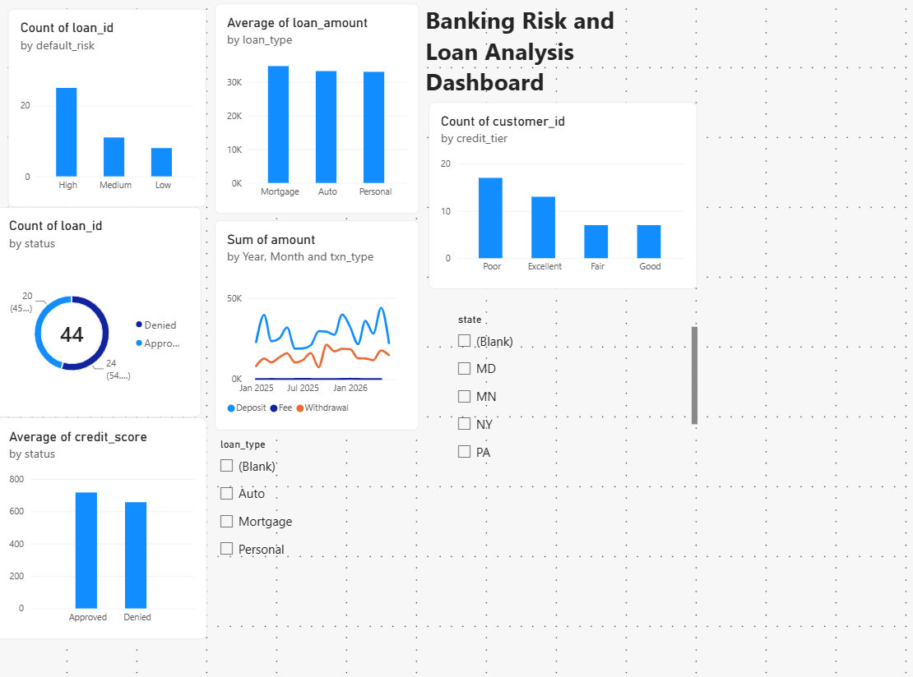

# Banking Risk & Customer Analysis (SQL)

A SQL project that builds a small banking database and answers business questions about loan risk, customer credit tiers, cash flow, and account fees.

**Data:** synthetic practice data (60 customers, accounts, 700 transactions, loans) generated by the script. Not real customer data.

**Tools:** SQL (SQLite), Python

**Tables:** customers, accounts, transactions, loans

**SQL skills shown:** JOINs, GROUP BY / HAVING, CASE segmentation, CTEs, subqueries, window functions (RANK), date aggregation

## Questions answered
1. Approval rate by default-risk level
2. Credit score and income of approved vs denied borrowers
3. Customer credit tiers
4. Largest approved loans (ranked)
5. Monthly deposits vs withdrawals
6. Customers paying the most account fees
7. High-risk loans that were still approved
8. Loan type performance

## Key findings
- Low-risk loans were approved 100% of the time, medium 73%, and high only 16%.
- Approved borrowers averaged a 717 credit score vs 656 for denied borrowers.
- 4 high-risk loans were still approved; the largest loan-to-income ratio was 113%, worth monitoring.
- Mortgages had the most high-risk loans (11 of 17).

## Run it
`python banking_sql_project.py` creates `banking.db` and `results.md`.
